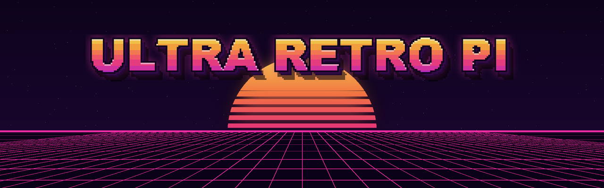

<div align="center">



<br>



### Distro de emulação retrô para a **Orange Pi PC Plus** (Allwinner H3)
*Baseada no Neo-EmuELEC-H3 / EmuELEC 4.5 — afinada para o Cortex-A7 e a Mali-400.*

<br>

[](../../releases/latest)
[](#-select-player--o-hardware)
[](#-select-player--o-hardware)
<br>
[](https://github.com/EmuELEC/EmuELEC)
[](https://github.com/libretro/RetroArch)
[](licenses/)

</div>


```
╔══════════════════════════════════════════════════════════════════╗
║   ★  U L T R A   R E T R O   P I  ★           CREDIT 01   1UP    ║
║                                                                  ║
║   ► STAGE 1 ........ BAIXAR A IMAGEM                             ║
║   ► STAGE 2 ........ GRAVAR NO CARTÃO                            ║
║   ► STAGE 3 ........ PRIMEIRO BOOT                               ║
║   ► POWER-UPS ...... O QUE TEM DE NOVO                           ║
║   ► HI-SCORE ....... OVERCLOCK                                   ║
║   ► BOSS FIGHT ..... COMPILAR DO ZERO                            ║
║   ► CREDITS ........ QUEM FEZ ISSO POSSÍVEL                      ║
╚══════════════════════════════════════════════════════════════════╝
```


## 🕹️ SELECT PLAYER — o hardware

| | |
|---|---|
| **Placa** | Orange Pi **PC Plus** (a versão com eMMC) |
| **SoC** | Allwinner H3 — 4× Cortex-A7 |
| **GPU** | Mali-400 MP2 (OpenGL ES 2.0) |
| **RAM** | 1 GB |
| **Wi-Fi** | Realtek RTL8189FTV (já carregado no boot) |
| **Saída** | HDMI 720p (o ponto ideal para o H3) |

> [!NOTE]
> A imagem é feita para a **PC Plus** (`UBOOT_SYSTEM=opipcplus`). A Orange Pi PC comum usa outro arquivo de configuração e não tem eMMC nem Wi-Fi.


## ▶ STAGE 1 — baixar a imagem

Vá em **[Releases](../../releases/latest)** e baixe `ULTRA-RETRO-PI-V1.0-opipcplus.img.gz`.
Confira o arquivo com o `.sha256` da mesma release (opcional, mas evita gravar um download corrompido).

## ▶ STAGE 2 — gravar no cartão

1. Abra o **[balenaEtcher](https://etcher.balena.io/)** → *Flash from file* → escolha o `.img.gz` (não precisa descompactar).
2. Selecione o cartão microSD (8 GB ou mais; quanto maior, mais espaço para ROMs).
3. *Flash!* e coloque o cartão na Orange Pi.

## ▶ STAGE 3 — primeiro boot

```
 ┌───────────────────────────────────────────────────────────┐
 │  1º boot  → cria a tabela de partições do cartão inteiro  │
 │  REINICIA → aumenta o armazenamento e formata a EEROMS    │
 │  REINICIA → menu do EmulationStation  ►  PRESS START      │
 └───────────────────────────────────────────────────────────┘
```

* O sistema **reinicia duas vezes sozinho** na primeira vez. **Não desligue** nessa hora.
* O cartão vira duas áreas: **4 GB** de sistema/configuração e o **resto para ROMs**.
* A partição de ROMs se chama **`EEROMS`** e é **FAT32**: coloque o cartão no PC e ela aparece no **Windows 10/11** como um pendrive. É só copiar as ROMs para `roms/<sistema>/`.
* Nomes com acento (ex.: `Pokémon`) funcionam dos dois lados.


## ⭐ POWER-UPS — o que o ULTRA RETRO PI traz

| | Recurso | Detalhe |
|:-:|---|---|
| 🎨 | **Tema ComicBook como padrão** | Revisado: visão em grade, menus, coleções automáticas e por gênero com arte no mesmo estilo, imagens otimizadas para a VRAM do H3 |
| 👾 | **Console em 16 bits na tela de cada sistema** | O console em pixel art estourando no canto, com a estrela "POW" do tema — 70 sistemas |
| ⏻ | **SAFE SHUTDOWN** | No carrossel de sistemas (com arte no estilo do tema), no menu principal e no menu da lista de jogos — desliga sem corromper o cartão |
| 🚀 | **Menu de overclock** | *Configurações do sistema → Overclock*, com volta automática se travar (veja o HI-SCORE) |
| 🕹️ | **Auto Games Setup** | Arcade abre no FBNeo; em *Setup → Auto Games Setup (Arcade)* cada `.zip` é conferido e vai para o núcleo cujo ROMset bate (FBNeo ou MAME 2003-Plus), com relatório de BIOS e jogos faltando |
| 🔌 | **Controles no GPIO** | Liga e desliga em *Setup → GPIO Controls (Ativar/Desativar)* ou no menu START (*Controles no GPIO*) |
| 🖼️ | **Scraper SteamGridDB** | Capas, *heroes* e logos do SteamGridDB — basta colocar sua API key no menu do scraper |
| 💾 | **Redimensionamento automático** | No primeiro boot, e de novo quando quiser em *Danger Zone → Expandir armazenamento para o cartão inteiro* |
| 🪟 | **ROMs visíveis no Windows** | Partição `EEROMS` em FAT32 (tipo 0x0C), sem precisar de rede |
| 🌎 | **Idioma que funciona** | O EmulationStation lê as traduções direto dos `.po` (corrige o [issue #60](https://github.com/asakous/Neo-EmuELEC-H3/issues/60)); pt-BR revisado |
| 🔄 | **RetroArch 1.22.2** | Com os patches do EmuELEC |
| 🧩 | **96 núcleos libretro** | 72 atualizados e 6 novos: **fake-08** (PICO-8), **FreeChaF** (Channel F), **JAXE** (CHIP-8), **LowRes NX**, **Gearlynx** (Lynx), **Geargrafx** (PC Engine) |
| ⚡ | **Afinado para o H3** | 720p, zram, núcleos padrão mais leves (gpSP, Snes9x 2010, FCEUmm, PicoDrive, FBNeo), transições instantâneas |
| 📶 | **Wi-Fi da PC Plus** | Driver RTL8189FS carregado no boot, com endereço MAC fixo |
| 🧹 | **Sem peso morto** | Dreamcast/Naomi/Atomiswave, PSP, N64 e a seção Ports foram tirados — não rodam bem na Mali-400 |

### 🎮 Alguns sistemas no menu

> **Nintendo** NES · Famicom Disk System · SNES · Game Boy · Game Boy Color · Game Boy Advance · Virtual Boy · Pokémon Mini · Game & Watch
> **Sega** Master System · Mega Drive / Genesis · Sega CD · 32X · Game Gear · SG-1000
> **Sony** PlayStation
> **NEC** PC Engine / TurboGrafx-16 · PC Engine CD · SuperGrafx · PC-FX
> **SNK** Neo Geo · Neo Geo CD · Neo Geo Pocket / Color
> **Arcade** FBNeo · MAME 2003-Plus · MAME 2010 · CPS1 / CPS2 / CPS3
> **Atari** 2600 · 5200 · 7800 · 800 · Lynx · ST
> **Computadores** Amiga · Commodore 64 / 128 / VIC-20 · MSX / MSX2 · ZX Spectrum · Amstrad CPC · X68000 · PC-98 · DOS · ScummVM
> **Fantasia** PICO-8 · TIC-80 · LowRes NX · CHIP-8 · Fairchild Channel F · Uzebox
> **Outros** WonderSwan · ColecoVision · Intellivision · Vectrex · Odyssey² · Doom (PrBoom) · Wolfenstein 3D (ECWolf) · OpenBOR · Solarus · EasyRPG


## 🏆 HI-SCORE — overclock

*Configurações do sistema → Overclock*. Se o sistema travar antes de **3 minutos** num perfil novo, ele **volta sozinho para 1,296 GHz** no boot seguinte. Para conferir se pegou, veja *Frequência atual do processador* no menu **Informações**.

| Perfil | Clock | Para quê |
|---|:-:|---|
| Economia | 1,008 GHz | Menos calor, jogos leves |
| — | 1,2 GHz | |
| **Padrão** | **1,296 GHz** | **O equilíbrio do H3** |
| Overclock | 1,344 GHz | Um empurrão extra |
| Extremo | 1,44 GHz @ 1,40 V | Exige dissipador (e sorte no chip) |
| Extremo | 1,536 GHz @ 1,50 V | Exige dissipador **e** ventoinha |

> [!WARNING]
> Os perfis extremos aumentam tensão e temperatura. Use dissipador, e ventoinha no de 1,536 GHz. Cada chip aguenta um limite diferente.


## 👾 BOSS FIGHT — compilar do zero

Precisa de **Ubuntu 20.04** (nativo, VM ou WSL2), uns **60 GB** livres e algumas horas.

```bash
git clone https://github.com/luisxl15/ULTRA-RETRO-PI---EMUELEC-FOR-ORANGE-PI-PC-PLUS.git Neo-EmuELEC-H3
cd Neo-EmuELEC-H3
PROJECT=H3 ARCH=arm DISTRO=EmuELEC UBOOT_SYSTEM=opipcplus make image
```

A imagem sai em `target/`. Em [`tools/ultra-retro-pi/`](tools/ultra-retro-pi/) estão os scripts usados para gerar esta release:

| Script | O que faz |
|---|---|
| `wsl-setup.sh` | Prepara um Ubuntu 20.04 mínimo (WSL) com todas as dependências do build |
| `run-build.sh` | Roda o build, mede o disco e para sozinho se o espaço do Windows acabar |
| `watch-build.sh` | Painel ao vivo: progresso, pacotes compilando, CPU e disco |
| `check-image.sh` | Confere dentro da imagem gerada se tudo do ULTRA RETRO PI está lá |

> [!TIP]
> No WSL2, deixe memória para o Windows (ex.: `memory=4GB`, `processors=6` no `.wslconfig` de uma máquina com 8 GB); senão o `pagefile.sys` cresce e enche o disco.


## 🎖️ CREDITS

* **[asakous / Neo-EmuELEC-H3](https://github.com/asakous/Neo-EmuELEC-H3)** — o porte do EmuELEC para o Allwinner H3 que é a base deste projeto ([README original](docs/README-Neo-EmuELEC-H3.md))
* **[EmuELEC](https://github.com/EmuELEC/EmuELEC)** (Shanti Gilbert), **[CoreELEC](https://coreelec.org)**, **[LibreELEC](https://libreelec.tv)** e **[Lakka](https://www.lakka.tv)**
* **[Batocera EmulationStation](https://github.com/batocera-linux/batocera-emulationstation)** e **[libretro / RetroArch](https://www.libretro.com)**
* **[TMNTturtleguy](https://github.com/TMNTturtleguy/es-theme-ComicBook)** — tema ComicBook
* **[Eric Hettervik (Rookervik)](https://github.com/ehettervik/es-theme-pixel-metadata)** — consoles em pixel art do tema Pixel-Metadata, usados na tela de sistema
* Todos os autores dos emuladores e núcleos incluídos

<div align="center">

<br>



**GAME OVER?** Achou um bug? Abra uma **[issue](../../issues)** — CONTINUE? 10… 9… 8…

<sub>Software livre sob a GPL-2.0 (veja <a href="licenses/">licenses/</a>). Marcas citadas pertencem aos seus donos.</sub>

</div>
